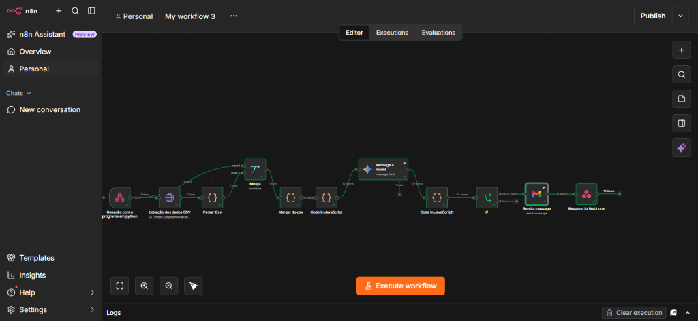
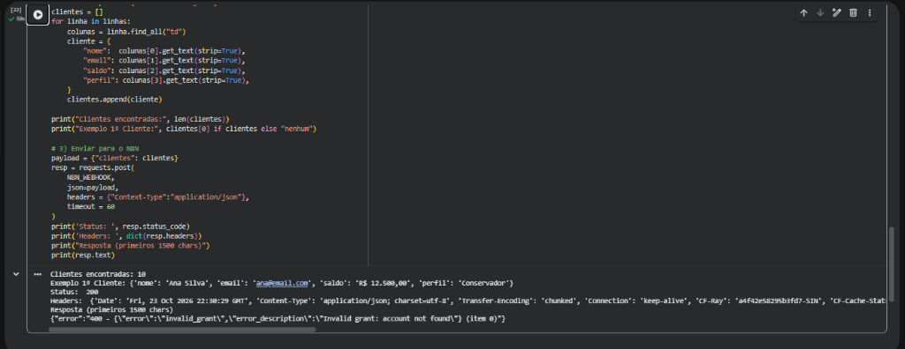
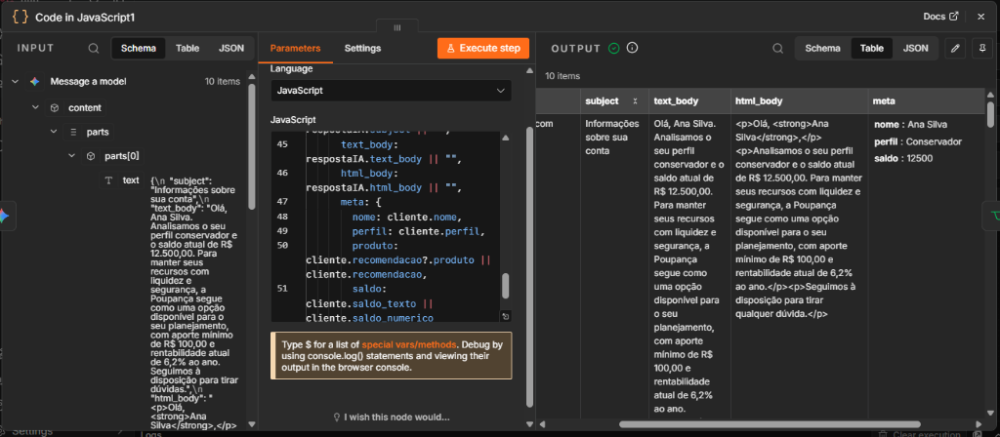

# 🤖 Assistente de Investimentos Inteligente com RPA, n8n e IA Generativa (Google Gemini)

Projeto desenvolvido para o desafio prático **"Criando um processo de RPA com n8n e Python"**, integrante do bootcamp **Santander - Automação com n8n** na plataforma da [Digital Innovation One (DIO)](https://www.dio.me/).

O projeto consiste em um ecossistema completo de automação financeira que combina técnicas de **RPA (Robotic Process Automation)** em Python, orquestração de workflows low-code no **n8n**, inteligência artificial generativa com **Google Gemini** e integração com **Gmail** para envio de recomendações personalizadas de investimento.

---

## 📌 Sumário
- [Visão Geral e Arquitetura](#-visão-geral-e-arquitetura)
- [Tecnologias e Ferramentas](#-tecnologias-e-ferramentas)
- [Estrutura do Repositório](#-estrutura-do-repositório)
- [Etapas de Implementação](#-etapas-de-implementação)
  - [1. RPA: Extração de Clientes (Python + BeautifulSoup)](#1-rpa-extração-de-clientes-python--beautifulsoup)
  - [2. Comunicação e Integração (Cloudflare Tunnel)](#2-comunicação-e-integração-cloudflare-tunnel)
  - [3. Ingestão e Processamento do Catálogo (n8n)](#3-ingestão-e-processamento-do-catálogo-n8n)
  - [4. Regras de Negócio e Cruzamento de Dados (Matching)](#4-regras-de-negócio-e-cruzamento-de-dados-matching)
  - [5. IA Generativa: Geração de Mensagens Personalizadas](#5-ia-generativa-geração-de-mensagens-personalizadas)
  - [6. Normalização, Validação com Regex e Envio](#6-normalização-validação-com-regex-e-envio)
- [Decisões Técnicas e Solução de Problemas](#-decisões-técnicas-e-solução-de-problemas)
- [Evidências e Demonstração do Fluxo](#-evidências-e-demonstração-do-fluxo)
- [Como Reproduzir este Projeto](#-como-reproduzir-este-projeto)
- [Autor](#-autor)

---

## 🏗️ Visão Geral e Arquitetura

O pipeline funciona em um fluxo contínuo de ponta a ponta:

```mermaid
flowchart LR
    subgraph RPA ["Etapa 1: RPA (Python)"]
        A["🌐 GitHub Pages<br>(docs/index.html)"] -->|Scraping| B["🐍 Notebook Python<br>(BeautifulSoup)"]
    end

    subgraph Tunnel ["Etapa 2: Túnel Seguro"]
        B -->|HTTP POST| C["☁️ Cloudflare Tunnel<br>(trycloudflare.com)"]
    end

    subgraph N8N ["Etapa 3: Orquestração no n8n"]
        C --> D["⚡ Webhook<br>(Conexão com Python)"]
        D --> E["📥 HTTP Request<br>(Download data.csv)"]
        E --> F["⚙️ Code: Parser CSV"]
        D --> G["🔀 Merge<br>(Combine)"]
        F --> G
        G --> H["🧠 Code: Matching<br>(Perfil x Saldo)"]
        H --> I["📋 Code: Copy Rules"]
        I --> J["✨ Google Gemini<br>(Geração do E-mail)"]
        J --> K["🧹 Code: Normalização JSON"]
        K --> L{"🔍 If: Validação Regex<br>(E-mail Válido?)"}
        L -->|Sim| M["✉️ Gmail: Disparo"]
        M --> N["↩️ Respond to Webhook"]
    end

    classDef source fill:#E3F2FD,stroke:#1E88E5,stroke-width:1px,color:#0D47A1;
    classDef rpa fill:#E8F5E9,stroke:#43A047,stroke-width:1px,color:#1B5E20;
    classDef n8n fill:#FFF3E0,stroke:#FB8C00,stroke-width:1px,color:#E65100;
    classDef ai fill:#F3E5F5,stroke:#8E24AA,stroke-width:1px,color:#4A148C;

    class A source;
    class B rpa;
    class C,D,E,F,G,H,I,K,L,M,N n8n;
    class J ai;
```



---

## 🛠️ Tecnologias e Ferramentas

| Ferramenta | Utilização no Projeto |
| :--- | :--- |
| **Python 3 / Google Colab** | Execução do robô de RPA para raspagem web e envio de dados via HTTP POST. |
| **BeautifulSoup4 & Requests** | Bibliotecas para extração e parseamento dos dados da tabela HTML de clientes. |
| **Cloudflare Tunnel (`cloudflared`)** | Exposição segura e gratuita da porta local do n8n para a internet (sem custo de cloud). |
| **n8n (Self-Hosted via Docker)** | Plataforma central de automação e orquestração dos fluxos e regras de negócio. |
| **JavaScript (ES6)** | Limpeza de moeda (BRL), matching de investimentos, sanitização de JSON e regras de copy. |
| **Google Gemini API (`gemini-3.1-flash-lite`)** | Modelo de Linguagem (LLM) para geração dinâmica de copy humanizada e ética. |
| **Expressões Regulares (Regex)** | Validação de formato de e-mail no nó condicional `If`. |
| **Gmail API / Node Gmail** | Componente de envio e automação de e-mails para os clientes. |

---

## 📁 Estrutura do Repositório

```text
.
├── README.md                   # Documentação completa e detalhada do projeto
├── n8n/
│   └── workflow.json           # Workflow exportado do n8n (MVP + IA + Gmail)
├── rpa/
│   └── extrair_clientes.ipynb  # Notebook Python de automação RPA (BeautifulSoup)
├── docs/
│   ├── index.html              # Página simulada com tabela de clientes
│   └── data.csv                # Catálogo de produtos financeiros por perfil
└── prints/                     # Prints comprobatórios da execução de ponta a ponta
    ├── 01_canvas_workflow.png
    ├── 02_execucao_python.png
    └── 03_resultado_ia.png
```

---

## ⚙️ Etapas de Implementação

### 1. RPA: Extração de Clientes (Python + BeautifulSoup)
O script Python realiza o scraping na página simulada de clientes, coletando nome, e-mail, saldo e perfil de investidor (*Conservador*, *Moderado* ou *Arrojado*), montando o payload e enviando via POST para o n8n:

```python
import requests
from bs4 import BeautifulSoup

URL_PAGINA = "https://digitalinnovationone.github.io/dio-lab-assistente-investimentos-rpa-n8n/"
N8N_WEBHOOK = "https://SEU_DOMINIO.trycloudflare.com/webhook/clientes"

html = requests.get(URL_PAGINA, timeout=30).text
soup = BeautifulSoup(html, "html.parser")
linhas = soup.select("#clientes tbody tr")

clientes = []
for linha in linhas:
    colunas = linha.find_all("td")
    clientes.append({
        "nome": colunas[0].get_text(strip=True),
        "email": colunas[1].get_text(strip=True),
        "saldo": colunas[2].get_text(strip=True),
        "perfil": colunas[3].get_text(strip=True),
    })

resp = requests.post(N8N_WEBHOOK, json={"clientes": clientes}, timeout=60)
print(f"Status: {resp.status_code}")
```

### 2. Comunicação e Integração (Cloudflare Tunnel)
Como o n8n foi executado em ambiente local (Docker na porta `5678`) e o script rodava no Google Colab, utilizou-se o Cloudflare Tunnel para viabilizar a comunicação gratuita e segura entre os dois ambientes:
```bash
docker run --rm -it cloudflare/cloudflared:latest tunnel --no-autoupdate --url http://host.docker.internal:5678
```

### 3. Ingestão e Processamento do Catálogo (n8n)
* **HTTP Request:** Baixa o arquivo `data.csv` com as opções de investimento.
* **Parser Csv (Code Node):** Converte as linhas do CSV em objetos JSON e normaliza o campo `minimo` para número.

### 4. Regras de Negócio e Cruzamento de Dados (Matching)
No nó **Merger do csv**:
* Converte o saldo de string (`"R$ 12.500,00"`) para valor decimal (`12500.00`).
* Cruza o perfil do cliente com o catálogo de investimentos, respeitando o saldo mínimo:
  $$\text{Perfil Compatível} \land \text{Saldo do Cliente} \ge \text{Aporte Mínimo}$$
* Prepara as diretrizes de copywriting (`copy_rules`) para alimentar o modelo de IA:
  * Tom amigável e profissional;
  * Tamanho conciso (4 a 6 linhas);
  * Proibição estrita de promessas de lucros ou garantias.

### 5. IA Generativa: Geração de Mensagens Personalizadas
* O nó **Message a model** utiliza o **Google Gemini** (`models/gemini-3.1-flash-lite`).
* O prompt instrui a IA a atuar como um consultor financeiro ético, gerando a resposta estruturada em JSON com `subject`, `text_body` e `html_body`.

### 6. Normalização, Validação com Regex e Envio
* **Code in JavaScript1 (Sanitização):** Remove delimitadores de markdown (```` ```json ````) e valida a resposta da IA.
* **If (Validação Regex):** Garante a conformidade do endereço de e-mail antes do envio com a expressão:
  ```regex
  ^[^@\s]+@[^@\s]+\.[^@\s]+$
  ```
* **Send a message (Gmail):** Dispara o e-mail personalizado formatado em HTML.
* **Respond to Webhook:** Retorna a confirmação com código HTTP `200` para o cliente chamador.

---

## 💡 Decisões Técnicas e Solução de Problemas

1. **Contorno de Rate Limit do Google Gemini:**  
   Para evitar erros de cota (HTTP 429) no plano gratuito do Google Gemini decorrentes do envio simultâneo de múltiplos clientes, configurou-se **Retry on Fail** (4 tentativas com 5.000 ms de intervalo) diretamente nas *Settings* do nó.

2. **Resiliência no Envio de E-mails com `Continue On Fail`:**  
   Como a base de clientes do desafio possui e-mails de demonstração (`ana@email.com`), o nó do Gmail foi configurado com **`On Error: Continue`**. Isso assegura que o fluxo não trave caso uma conta de demonstração não receba a mensagem, permitindo que a execução atinja o nó `Respond to Webhook` com sucesso.

3. **Algoritmo de Busca e Limpeza Defensiva da IA:**  
   Implementação de um algoritmo de extração profunda em JavaScript que rastreia a saída da LLM independentemente de pequenas variações de retorno do provedor.

---

## 📸 Evidências e Demonstração do Fluxo

### 1. Canvas do Workflow no n8n
> *Visão geral de todos os nós conectados e executados com sucesso:*


### 2. Execução do Script RPA no Python / Colab
> *Execução com extração dos 10 clientes e retorno `Status: 200`:*


### 3. Recomendações e Mensagens Geradas pela IA
> *Detalhe do e-mail estruturado e personalizado gerado pelo Google Gemini:*



---

## 🚀 Como Reproduzir este Projeto

1. **Clone o repositório:**
   ```bash
   git clone https://github.com/SEU_USUARIO/dio-lab-assistente-investimentos-rpa-n8n.git
   ```
2. **Inicie o n8n:**
   ```bash
   docker run -it --rm --name n8n -p 5678:5678 docker.n8n.io/n8nio/n8n:latest
   ```
3. **Importe o fluxo:**
   * Acesse `http://localhost:5678`;
   * Importe o arquivo [workflow.json](n8n/workflow.json);
   * Configure a credencial da API do Google Gemini.
4. **Execute o RPA:**
   * Execute o notebook [extrair_clientes.ipynb](rpa/extrair_clientes.ipynb) apontando para o seu webhook.

---

## 👨‍💻 Autor

Desenvolvido por **Gabriel Farias**  
Trilha Santander - Automação com n8n | [Digital Innovation One (DIO)](https://www.dio.me/)
